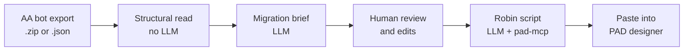

# Automation Anywhere → Power Automate Desktop

## What we are trying to achieve

1. **Understand** what an exported AA bot does (from `.json` or `.zip` uploads).
2. **Produce a clear migration brief** that a human can review and edit.
3. **Generate Robin script** that is as **correct and paste-ready** as we can make it, using official PAD actions and team-approved patterns—not guesswork from the model alone.

This folder contains a **small web application** (upload → analyze → edit brief → generate) plus the backend logic that orchestrates LLM calls and pad-mcp.

---

## End-to-end workflow (how a migration run works)



| Step | What happens | Who / what is involved |
|------|----------------|------------------------|
| **Upload** | User provides one or more AA bot exports. | Web UI |
| **Inspect (optional preview)** | We extract structure from the JSON: commands, packages, variables, approximate size—without calling an LLM. | Deterministic code |
| **Analyze** | An LLM writes a **migration brief** in Markdown: purpose, flow, data, integrations, uncertainties. | LLM only (no MCP) |
| **Review** | User edits the brief so business logic and priorities are right before code is generated. | Human in the loop |
| **Generate** | An **agent** (LLM) plans the PAD solution and **looks up** actions, types, and team patterns via pad-mcp, then outputs pasteable Robin. | LLM + MCP |
| **Use** | Developer copies Robin into PAD, converts to actions, tests, and refines. | PAD + developer |

**Multi-workflow packages:** When a upload contains several bots, the user can choose:

- **Individual** — separate brief and separate Robin output per workflow.
- **Combined** — one merged brief (and one Robin generation) for the whole package.

---

## Our approach in plain terms

We split the problem into **two different jobs** and use the right tool for each.

### 1. “What did the AA bot do?” (analysis)

- **Input:** Raw AA export JSON (possibly large or from different AA versions).
- **Technique:** We first build a **mechanical summary** (lists of commands, packages, variables, etc.) by walking the JSON. That grounds the LLM and reduces hallucination.
- **LLM role:** Turn structure + JSON into a readable **migration brief**. The model is instructed **not** to write Robin at this stage.
- **Why no MCP here:** MCP is specialized for **PAD development** (actions, patterns, types). It does not interpret AA exports; that is migration analysis, not catalog lookup.

### 2. “How do we implement this in PAD?” (Robin generation)

- **Input:** The edited migration brief
- **Technique:** A **tool-using agent loop**: the LLM can call pad-mcp many times (search patterns, look up actions, read types, fetch approved code snippets) before it writes the final script.
- **Why MCP here:** Robin must use **real action names, parameters, and types**. Generic LLM training is not enough for accurate, pasteable PAD code. MCP supplies **curated, searchable truth** at generation time.

This separation keeps analysis fast and focused, and puts **grounded PAD knowledge** only where it matters—script generation.

---

## What is MCP, and how we use it?

**MCP (Model Context Protocol)** is a standard way for an AI assistant to call **tools** on another service—in our case, **pad-mcp**.

Think of pad-mcp as a **specialized librarian** for Power Automate Desktop:

| Kind of knowledge | What it gives the agent |
|-------------------|-------------------------|
| **Action catalog** | Search and fetch exact PAD actions (IDs, parameters, examples). |
| **Type reference** | Correct data types and how to use them in Robin. |
| **Team patterns** | Approved snippets and conventions your maintainers have published. |
| **Development context** | Mode-specific guidance (Classic vs Power Fx). |

In this implementation:

1. The Robin generator connects to pad-mcp over HTTP (configured via `MCP_URL` and an API token).
2. Every MCP tool exposed by the server is available to the LLM as a **callable tool** (via LangChain).
3. The agent is instructed to follow a sensible workflow: find relevant **patterns**, **search actions**, resolve **types**, then write Robin in a code block.
4. The user’s **Classic / Power Fx** choice is passed on every catalog-related call so results match the target environment.

**Important:** The LLM still **decides** what to build from the migration brief. MCP does **not** replace reasoning—it **replaces guessing** about PAD syntax and approved team code.

---

## How MCP + LLM together improve Robin quality

Without MCP, a model tends to:

- Invent action names or parameters that PAD does not recognize.
- Miss team standards and already-approved solutions.
- Mix Classic and Power Fx styles incorrectly.

With MCP + our agent loop:

| Benefit | Explanation |
|---------|-------------|
| **Factual actions** | The model looks up actions and types before writing, similar to a developer using official docs. |
| **Reuse of approved patterns** | Published team snippets can be retrieved and adapted instead of reinventing flows. |
| **Mode consistency** | Classic vs Power Fx is enforced across tool calls, aligned with how pad-mcp filters content. |
| **Paste-oriented output** | The agent is prompted to return Robin in a clear code block for copy-paste into PAD. |
| **Traceable iteration** | The agent can take multiple tool steps (configurable limit) to refine lookups before answering. |

The output is still **draft quality**: a developer should paste, convert to actions, and test. MCP materially reduces “won’t compile in PAD” errors compared to LLM-only generation.

---

## Other design choices (manager-relevant)

| Choice | Rationale |
|--------|-----------|
| **Human-editable brief** | Migration is risky; we force a review step so SMEs can correct intent before code is generated. |
| **Pluggable LLM providers** | OpenAI, Google Gemini, or a custom HTTP API—selected in server config; model name in the UI. Supports piloting cost and quality without rewriting the app. |
| **Optional cost estimate** | UI can pass token pricing to estimate spend for a generation run—useful for trials and chargeback discussions. |
| **Thin custom UI** | Single-page web app + Express API: easy to demo, extend, or embed in a larger migration program. |
| **Sibling project: pad-mcp** | The MCP server lives in the parent repo; this app is a **consumer** that shows one production-style integration (AA migration assistant). |

---

## What needs to be running

For a full demo or pilot:

1. **pad-mcp** — MCP server with action catalogs and (optionally) published team patterns.
2. **This app** — `npm start` serves the UI and APIs (default port 3000).
3. **LLM credentials** — API key for the chosen provider (see `.env.example`).

Environment variables tie the app to pad-mcp (`MCP_URL`, `PAD_MCP_TOKEN`) and the LLM (`LLM_PROVIDER`, keys, optional default models).

---

## pad-mcp tools and Robin generation

The Robin agent does **not** hard-code a fixed tool list. On each generate request it connects to pad-mcp, calls **`listTools`**, and exposes **every tool the server registers for that API key** to the LLM (via LangChain). The model chooses which tools to call and with what arguments, up to `AGENT_MAX_STEPS` iterations (default 20).

**Before the loop**, our app always calls **`get_development_context`** once with the user’s Classic / Power Fx choice. That response is injected into the system prompt (`development_prompt`, global conventions, catalog rules). The LLM may call `get_development_context` again during the loop, but the first load is guaranteed.

For catalog and pattern tools, the app **automatically adds** `power_fx: "disabled"` or `"enabled"` on every call so they match the UI mode—even if the model omits it.

Authoritative tool definitions, roles, and argument shapes are in the parent project:

- [pad-mcp README — how the server works](../README.md)
- [Usage — tools, roles, and workflows](../docs/usage.md)
- [Catalog — action/type reference behavior](../docs/catalog.md)

### Tools available with a **Developer** API key (typical for this app)

These are the tools pad-mcp exposes when `PAD_MCP_TOKEN` is a Developer key (see [API keys](../docs/api-keys.md)). This is the usual setup for AA → PAD Robin generation.

| Tool | Used for Robin generation? | Purpose (short) |
|------|--------------------------|-----------------|
| `get_development_context` | **Yes** (required context) | Mode-specific guidance, bundled catalog rules, up to 20 global conventions. |
| `search_patterns` | **Yes** (when team snippets exist) | Search approved patterns by need (Excel, batching, email, etc.); returns previews only. |
| `get_pattern` | **Yes** | Fetch full Robin + metadata for a chosen `id` / `revision` from search. |
| `search_actions` | **Yes** | Search PAD action catalog by keywords/module, or fetch one action by exact `action_id`. |
| `search_type_reference` | **Yes** | Search or fetch PAD data types (exact `type_name` for full detail). |
| `export_knowledge` | Rarely | Paginated export of published patterns (portable JSON backup), not needed for a single migration run. |

**Robin workflow the model is steered toward** (see `src/agent.js`):

1. `search_patterns` when a team pattern might apply  
2. `get_pattern` for any relevant hit  
3. `search_actions` (search, then exact `action_id`) for actions to add or verify  
4. `search_type_reference` for parameter types  
5. Write pasteable Robin in a markdown code block  

Every development lookup must use the same `power_fx` as the user selected in the UI.

### Tools only with a **Maintainer** API key

If the token were a Maintainer key, the same six tools above would still appear, **plus** knowledge-management tools. Those are for curating the snippet library, **not** for the standard migration UI flow:

| Tool | Role |
|------|------|
| `get_usage_stats` | Aggregate developer tool usage |
| `list_patterns` | List pattern IDs/revisions including drafts |
| `save_draft` | Save a new draft revision |
| `publish_revision` | Publish an approved revision |
| `replace_pattern` | Replace and publish under the same ID |
| `unpublish_pattern` | Withdraw from developer access |
| `delete_pattern` | Permanently remove a pattern |
| `import_knowledge` | Import up to 20 entries as drafts |

Robin generation with a Developer key **cannot** invoke these write/maintenance tools even if the model asks—the server does not register them for that role.

### What the LLM does **not** use in this app

| Phase | MCP tools |
|-------|-----------|
| **AA bot analysis** (`/api/analyze-aa`) | None — LLM + mechanical JSON summary only |
| **AA inspect preview** (`/api/inspect-aa`) | None — deterministic parsing |

---

## Example dry run: how the LLM uses tools (illustrative)

The trace below is **fictional**—structured like real pad-mcp JSON responses, but **not** produced by running the MCP server. It shows how a generate request might unfold when the user chose **Classic** (`power_fx: "disabled"`) and the migration brief says: *read orders from Excel and write CSV files with 100 rows each* (similar to the parent [README](../README.md) example).

**Inputs**

- Migration brief (after human edit): numbered flow, file paths, batch size 100.  
- PAD mode: Classic.  
- App has already called `get_development_context({ "power_fx": "disabled" })` and placed guidance in the system prompt.

**Agent loop (simplified)**

| Step | Who | Action |
|------|-----|--------|
| 0 | App | `get_development_context` → conventions + `development_prompt` in system message (not shown again below). |
| 1 | LLM | Decides team may have a batching snippet → tool call **`search_patterns`**. |
| 1a | pad-mcp | `{"power_fx":"disabled","query":"split list fixed batch size","max_results":3}` → previews (id, revision, title, problem). |
| 2 | LLM | Picks a hit → **`get_pattern`**. |
| 2a | pad-mcp | `{"power_fx":"disabled","id":"list-batches","revision":2}` → full `robin_code`, inputs, pitfalls. |
| 3 | LLM | Needs Excel read actions → **`search_actions`** (search). |
| 3a | pad-mcp | `{"power_fx":"disabled","query":"read excel","module":"Excel"}` → summaries with `action_id`s. |
| 4 | LLM | **`search_actions`** (exact lookup). |
| 4a | pad-mcp | `{"power_fx":"disabled","action_id":"Excel.ReadFromExcel.ReadAllCells"}` → parameters, examples. |
| 5 | LLM | Checks a variable type → **`search_type_reference`**. |
| 5a | pad-mcp | `{"power_fx":"disabled","type_name":"List"}` → formatting rules for Robin. |
| 6 | LLM | **No further tool calls** → final answer with a Robin code block adapted from the brief, pattern, and catalog facts. |

**Illustrative tool payloads (step 1a — search preview)**

```json
{
  "results": [
    {
      "id": "list-batches",
      "revision": 2,
      "kind": "snippet",
      "title": "Split a list into fixed-size batches",
      "problem": "Process a list in groups of up to N items, including a final partial group."
    }
  ],
  "total": 1,
  "truncated": false
}
```

**Illustrative tool payloads (step 4a — action detail, excerpt)**

```json
{
  "record": {
    "action_id": "Excel.ReadFromExcel.ReadAllCells",
    "module": "Excel",
    "summary": "Read all used cells from an Excel instance into a table variable."
  }
}
```

**Illustrative final LLM message (excerpt)**

````markdown
```robin
# Orders batch export — generated from migration brief; test in PAD.
# ... Robin using looked-up Excel actions and adapted list-batching pattern ...
```
````

**Takeaways for readers**

- The LLM **plans** from the migration brief; tools supply **facts and approved snippets**, not the business story.  
- Search tools return **previews or summaries**; the model is expected to **follow up** with `get_pattern` or exact `action_id` / `type_name` lookups.  
- The same `power_fx` value is repeated on every catalog/pattern call so Classic and Power Fx catalogs do not mix.  
- If the model stops calling tools early, output may still be usable but less grounded; raising `AGENT_MAX_STEPS` allows more lookup rounds before the app stops the loop.

For more JSON argument examples (especially Power Fx), see [External action and type references](../docs/usage.md#external-action-and-type-references) in the usage doc.
